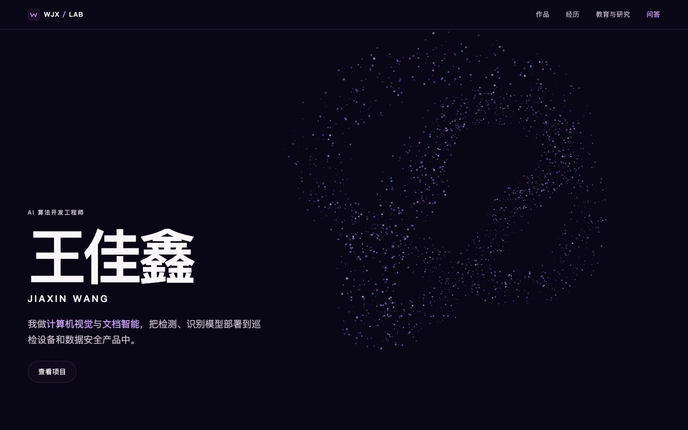
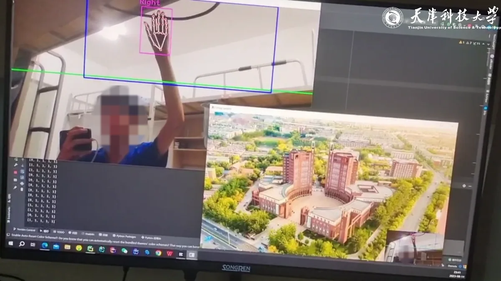
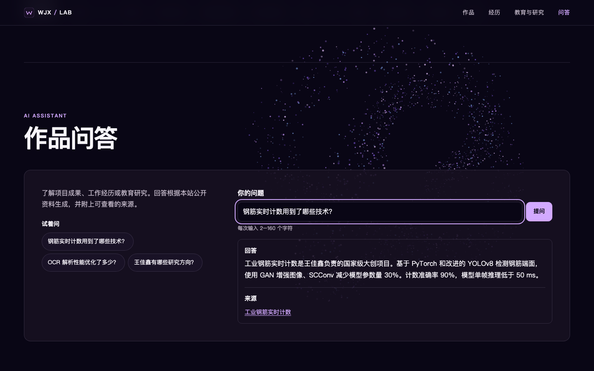

<h1 align="center">王佳鑫 · WJX LAB</h1>

<p align="center">个人简历、项目作品与 AI 问答 · 计算机视觉、文档智能与边缘部署</p>

<p align="center">
  <a href="https://106.52.107.206/"></a>
  <a href="#项目作品"></a>
  <a href="#本地预览"></a>
</p>

## 网页截图



首屏粒子会随鼠标移动与页面滚动改变形态。启用系统的减少动态效果设置时，背景以静态画面显示。

<details>
<summary>查看手机端截图</summary>


</details>

## 项目作品

| 工业钢筋实时计数 | EasyPPT | 手写数字检测与识别 |
| :--- | :--- | :--- |
|  |  |  |
| 用改进的 YOLOv8 检测钢筋端面，支持在 PDA 上实时计数。 | 通过手势控制演示与创作。 | 在实时画面中定位手写数字并显示识别结果。 |

更多作品包括图像风格迁移、MoveNet 姿态可视化、YOLOv8 竹签计数、手势搭积木和行人光流估计。点击站内项目卡片可查看实现过程和演示画面。[浏览项目详情](https://106.52.107.206/project-details.html)

## 作品问答

访客可以询问项目、工作经历、教育背景或研究成果。问答服务从整理后的公开资料中检索片段，通过本机 Ollama 的 `qwen3:0.6b` 筛选相关证据，返回资料原文和站内来源。关键词未命中时，服务会继续从公开资料的标题和正文查找相近片段。[打开作品问答](https://106.52.107.206/#assistant)



## 本地预览

站点使用原生 HTML、CSS 和 JavaScript。克隆仓库后，用 Python 3.9 或以上版本启动本地静态服务器。

```bash
git clone https://github.com/wjiaxin853-ctrl/wjxlab.cn.git
cd wjxlab.cn
python3 -m http.server 8000 --bind 127.0.0.1
```

启动后打开 [http://127.0.0.1:8000/](http://127.0.0.1:8000/)。

本地联调问答时，确保 Ollama 在 `127.0.0.1:11434` 上运行并已下载 `qwen3:0.6b`，再启动后端。

```bash
python3 -B assistant/server.py
```

可向 `http://127.0.0.1:8766/api/ask` 发送包含 `question` 字段的 JSON POST 测试回答。要在浏览器中联调，将网站同源的 `/api/ask` 转发到该后端。

## 目录说明

| 文件 | 用途 |
| --- | --- |
| [`index.html`](index.html) | 简历、项目和研究内容 |
| [`project-details.html`](project-details.html) | 项目详情、实现流程与演示截图 |
| [`project-details.css`](project-details.css) | 项目详情页布局 |
| [`style.css`](style.css) | 主题、响应式布局和打印样式 |
| [`site.js`](site.js) | Canvas 粒子背景与交互 |
| [`assistant.js`](assistant.js) | 作品问答的浏览器交互 |
| [`assistant/`](assistant/) | 公开资料索引与 Python 问答后端 |
| [`deploy/`](deploy/) | Nginx 问答路由、限流配置和 systemd 服务 |
| [`assets/`](assets/) | 网站图标与项目演示截图 |
| [`docs/images/`](docs/images/) | README 使用的网页截图 |

部署时，将 `index.html`、`project-details.html`、`style.css`、`project-details.css`、`site.js`、`assistant.js` 和 `assets/` 放到静态站点的发布根目录。问答后端单独从 `assistant/` 运行，Nginx 使用 `deploy/` 中的路由与限流配置。
