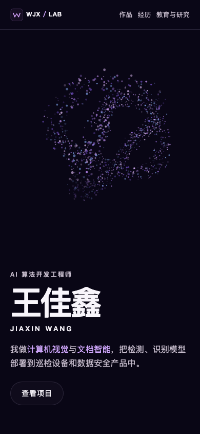
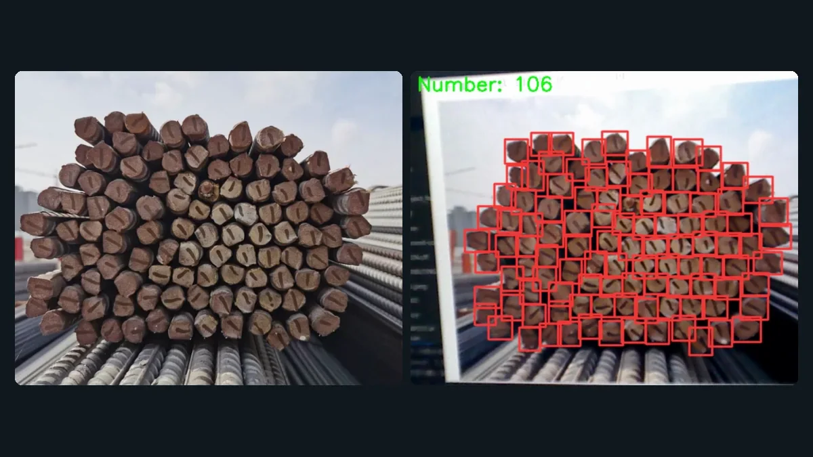
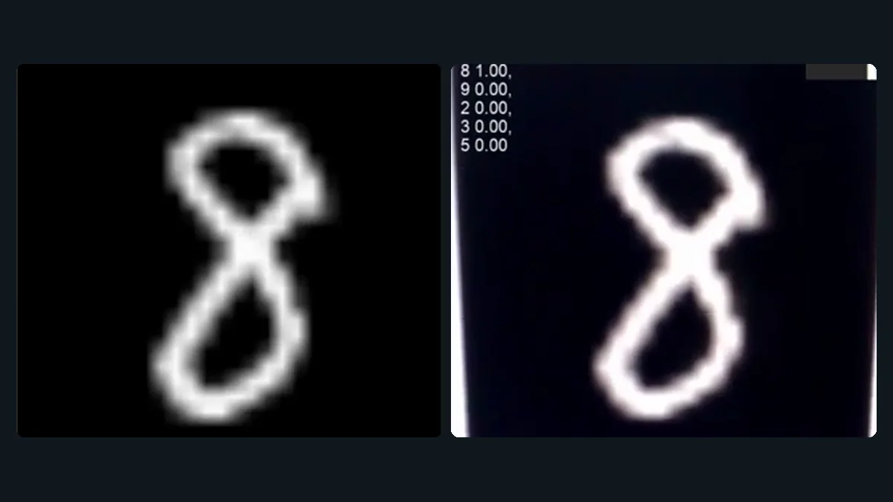

<h1 align="center">王佳鑫 · WJX LAB</h1>

<p align="center">个人简历与作品集 · 计算机视觉、文档智能与边缘部署</p>

<p align="center">
  <a href="https://106.52.107.206/"></a>
  <a href="#项目作品"></a>
  <a href="#本地预览"></a>
</p>

## 网页截图


首屏粒子会随鼠标移动与页面滚动改变形态。启用系统的减少动态效果设置时，背景以静态画面显示。

<details>
<summary>查看手机端截图</summary>



</details>

## 项目作品

| 工业钢筋实时计数 | EasyPPT | 手写数字检测与识别 |
| :--- | :--- | :--- |
|  |  |  |
| 用改进的 YOLOv8 检测钢筋端面，支持在 PDA 上实时计数。 | 通过手势控制演示与创作。 | 在实时画面中定位手写数字并显示识别结果。 |

## 本地预览

站点使用原生 HTML、CSS 和 JavaScript。克隆仓库后，用 Python 3 启动本地静态服务器。

```bash
git clone https://github.com/wjiaxin853-ctrl/wjxlab.cn.git
cd wjxlab.cn
python3 -m http.server 8000 --bind 127.0.0.1
```

启动后打开 [http://127.0.0.1:8000/](http://127.0.0.1:8000/)。

## 目录说明

| 文件 | 用途 |
| --- | --- |
| [`index.html`](index.html) | 简历、项目和研究内容 |
| [`style.css`](style.css) | 主题、响应式布局和打印样式 |
| [`site.js`](site.js) | Canvas 粒子背景与交互 |
| [`assets/`](assets/) | 网站图标与项目演示截图 |
| [`docs/images/`](docs/images/) | README 使用的网页截图 |

部署时，将 `index.html`、`style.css`、`site.js` 和 `assets/` 放到静态站点的发布根目录。
